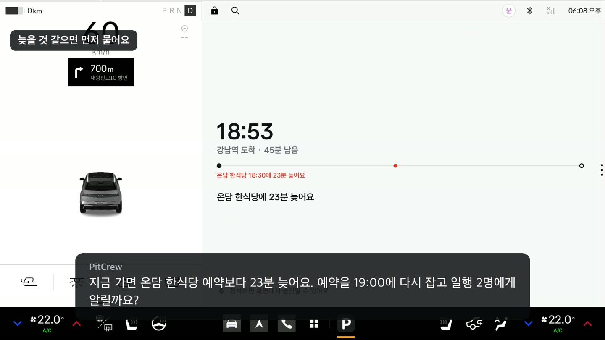
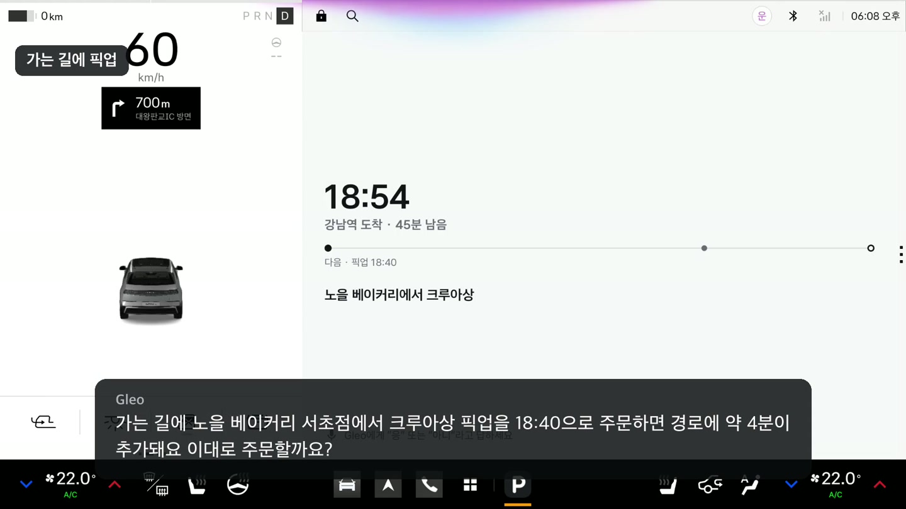
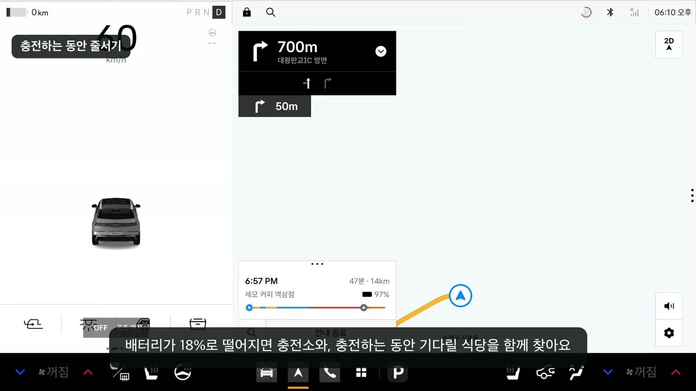
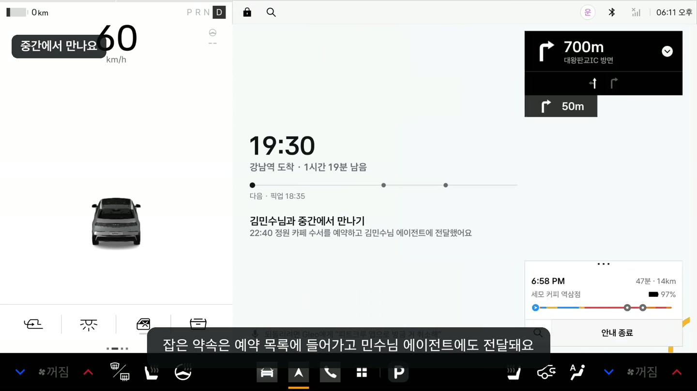
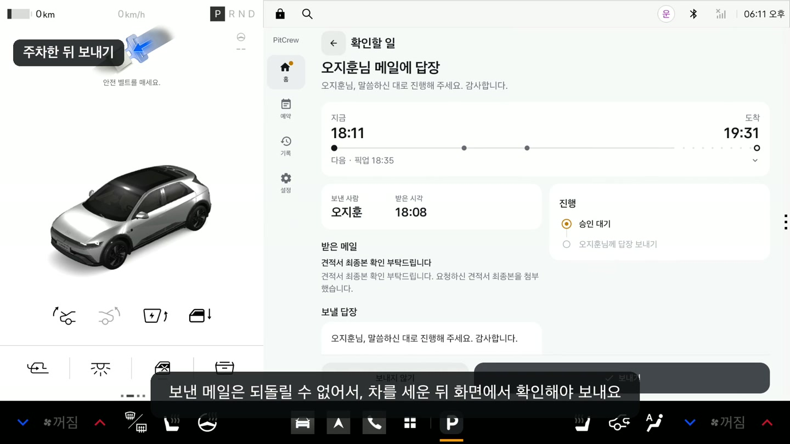

<div align="center">

# PitCrew

### 현대자동차 Pleos Connect에서 쓰는 차량용 비서

운전 중에 예약 바꾸고, 픽업 주문하고, 연락까지 해야 할 때 쓰는 앱입니다.

[**APK 다운로드**](apk/백슬래시파트너스_PitCrew_release.apk?raw=true) · [**데모 영상 보기 · 3분 53초**](docs/demo/pitcrew-demo.mp4) · [**바로 실행하기**](#실행-방법)

</div>

---

## 어떤 앱인가요?

길이 막혀 예약 시간에 늦을 것 같은데, 식당에 연락하고 일행에게도 알려야 할 때가 있습니다. 가는 길에 빵 하나 픽업하려고 해도 매장을 찾고, 주문하고, 내비에 경유지를 넣어야 하죠.

PitCrew는 이런 일을 차 안에서 말로 처리할 수 있게 만든 앱입니다. 현대자동차의 **Pleos Connect** 시스템을 기반으로, 내비게이션의 도착 예정 시간과 경로, 차량의 주행 상태와 배터리 잔량을 함께 확인합니다. Gleo 음성 명령으로 요청하면 상황에 맞는 작업을 제안하고, 확인을 받아 진행합니다.

## 데모 영상

아래는 **현대자동차 Pleos Connect 에뮬레이터**에서 촬영한 화면입니다. 첫 번째 이미지나 상단의 영상 링크를 누르면 전체 데모를 볼 수 있습니다.

일행·예약·매장·메일은 시연용 데이터로 동작합니다.

### 예약 시간에 늦을 것 같을 때

[](docs/demo/pitcrew-demo.mp4)

내비에 찍힌 도착 시간이 예약보다 늦으면, 예약을 미루고 일행에게도 알릴지 먼저 물어봅니다. 데모에서는 식당 예약을 19시로 바꾸고 일행 두 명에게 알려줍니다.

### 가는 길에 빵도 픽업하고

“피트크루 앱으로 가는 길에 노을 베이커리에서 크루아상 픽업 주문해줘.”

이렇게 말하면 얼마나 돌아가야 하는지, 몇 시에 받을 수 있는지 알려줍니다. 주문을 진행하면 내비에도 매장을 경유지로 넣어줍니다.



<details>
<summary><strong>충전 중 줄서기와 약속 잡는 장면도 보기</strong></summary>

### 충전하는 동안 줄서기

배터리가 얼마 남지 않았다면 충전하는 동안 근처 식당에 줄을 걸어둘지 물어봅니다. 데모에서는 배터리 18%인 상황을 보여줍니다.



### 중간에서 만나기로 했다면

상대가 있는 곳과 비는 시간을 보고 중간 지점의 카페를 잡습니다. 예약한 내용은 상대 에이전트에도 전달합니다.



</details>

### 메일 답장은 차를 세운 뒤에

운전 중에 온 메일은 읽어주고 답장까지 준비해 둡니다. 실제로 보내는 건 차를 세운 뒤, 화면에서 내용을 확인하고 나서입니다.



---

## 실행 방법

### APK로 바로 실행

현대자동차 Pleos Connect 에뮬레이터를 켜고 APK를 설치합니다.

```bash
adb install apk/백슬래시파트너스_PitCrew_release.apk
```

설치가 끝나면 런처에서 PitCrew를 열면 됩니다. release 빌드는 별도 서버 없이 앱 안의 시연용 데이터(일행·예약·매장·메일)로 실행됩니다.

### 소스에서 실행(서버 연동)

```bash
scripts/emulator.sh start          # 헤드리스 부팅, 창이 필요하면 --window
cd app && ./gradlew installDebug   # 런처에서 PitCrew 실행
cd server && pnpm install && pnpm db:up && pnpm seed && pnpm dev
```

- 서버는 기본 `127.0.0.1:3000`에서 실행되고, debug 앱은 에뮬레이터 안에서 `http://10.0.2.2:3000`으로 연결됩니다.
- DB는 Docker의 MySQL 8.4(호스트 포트 3308)를 사용합니다. `pnpm seed`는 현재 시각에 맞춰 시연용 데이터를 넣습니다.

## 테스트 환경 및 필요한 설정

- 개발 환경: JDK 17, Android SDK(platform 35), Node 22.9 이상, pnpm 10, Docker(MySQL 8.4)
- 설치 후 앱을 한 번 열어야 Gleo 음성 명령이 앱에 전달됩니다. 강제 종료한 뒤에도 한 번 다시 열어주세요.
- 처음 실행할 때 사용 안내(온보딩)에서 "위치 사용 허용"을 눌러 위치 권한을 허용해주세요.
- 지각 대응·경로상 픽업·충전은 내비게이션에 목적지를 정해 경로가 있어야 동작합니다.
- 에뮬레이터 시간대는 서울로 설정합니다(`settings put global auto_time_zone 0`, `cmd alarm set-timezone Asia/Seoul`).
- 차량 상태(기어·속도·배터리)는 Virtual Console로 바꿀 수 있습니다.

  ```bash
  scripts/vconsole.sh drive 40   # D단 40km/h
  scripts/vconsole.sh park       # P단 정차
  scripts/vconsole.sh battery 18 # 배터리 18%
  ```

- 마이크 없이도 Gleo 음성 명령을 테스트할 수 있습니다. 에뮬레이터 Gleo의 테스트 입력을 사용합니다.

  ```bash
  adb shell "am broadcast -a ai.umos.intent.action.ASR --es ASR '피트크루 앱으로 11시 예약 지각 처리해줘'"
  ```

## 에뮬레이터 버전과 화면 규격

- Pleos Connect Emulator 2.1.0 (Android 14, API 34, `pleos_car_emulator` arm64-v8a 시스템 이미지)
- 화면 2560×1440, 160dpi

## APK 파일

- [백슬래시파트너스_PitCrew_release.apk 다운로드](apk/백슬래시파트너스_PitCrew_release.apk?raw=true): 서명한 release 빌드(APK Signature Scheme v3)
